## ch2/pqc/pqc_mkrand16.c

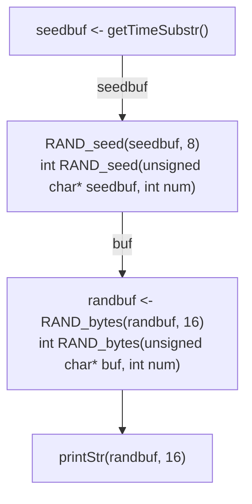

## ch2/pqc/pqc_mldsa_genkey.c

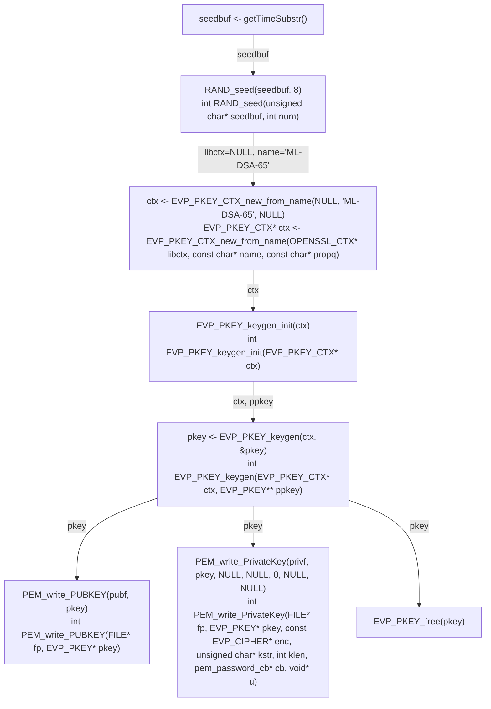

## ch3/pqc/pqc_aes_256_cbc.c

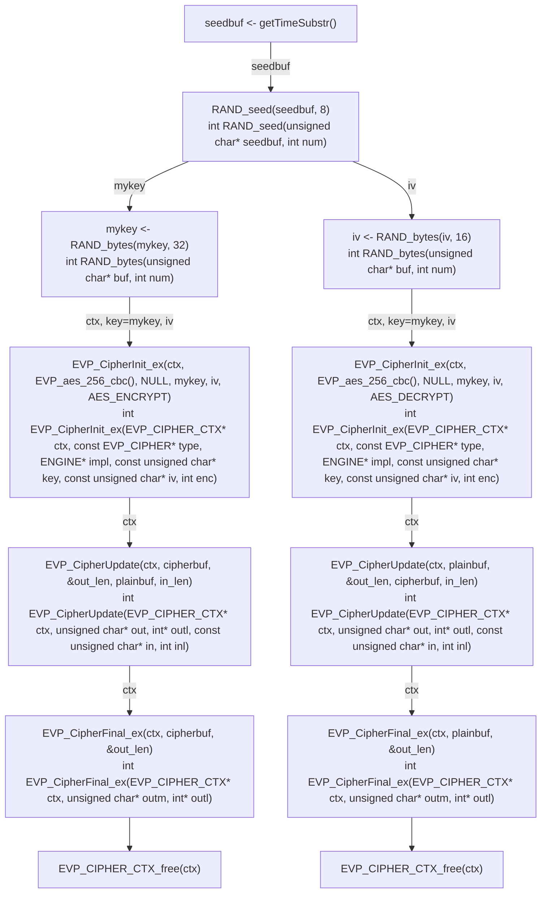

## ch4/pqc/pqc_mlkem_envelope.c

```mermaid
flowchart TD
    A["pub <- read_public_key(path)
EVP_PKEY* pub <- read_public_key(const char* path)"] -->|"pub"| B["kem <- EVP_PKEY_CTX_new_from_pkey(NULL, pub, NULL)
EVP_PKEY_CTX* kem <- EVP_PKEY_CTX_new_from_pkey(OPENSSL_CTX* libctx, EVP_PKEY* pkey, const char* propq)"]
    B -->|"kem"| C["EVP_PKEY_encapsulate_init(kem, NULL)
int EVP_PKEY_encapsulate_init(EVP_PKEY_CTX* ctx, const OSSL_PARAM params[])"]
    C -->|"kem, secret"| D["EVP_PKEY_encapsulate(kem, header + 4, &ct_len, secret, &secret_len)
int EVP_PKEY_encapsulate(EVP_PKEY_CTX* ctx, unsigned char* out, size_t* outlen, unsigned char* secret, size_t* secretlen)"]
    D -->|"nonce"| E["RAND_bytes(header + ... , NONCE_LEN)
int RAND_bytes(unsigned char* buf, int num)"]
    E -->|"cipher, key=secret, iv=nonce"| F["EVP_EncryptInit_ex(cipher, EVP_aes_256_gcm(), NULL, secret, nonce)
int EVP_EncryptInit_ex(EVP_CIPHER_CTX* ctx, const EVP_CIPHER* type, ENGINE* impl, const unsigned char* key, const unsigned char* iv)"]
    F -->|"cipher"| G["EVP_EncryptUpdate(cipher, out_buf, &n, in_buf, r)
int EVP_EncryptUpdate(EVP_CIPHER_CTX* ctx, unsigned char* out, int* outl, const unsigned char* in, int inl)"]
    G -->|"cipher"| H["EVP_EncryptFinal_ex(cipher, out_buf, &n)
int EVP_EncryptFinal_ex(EVP_CIPHER_CTX* ctx, unsigned char* outm, int* outl)"]
    H -->|"tag"| I["EVP_CIPHER_CTX_ctrl(cipher, EVP_CTRL_GCM_GET_TAG, TAG_LEN, tag)
int EVP_CIPHER_CTX_ctrl(EVP_CIPHER_CTX* ctx, int cmd, int p1, void* p2)"]
    I -->|"priv"| J["priv <- read_private_key(path)
EVP_PKEY* priv <- read_private_key(const char* path)"]
    J -->|"priv"| K["kem2 <- EVP_PKEY_CTX_new_from_pkey(NULL, priv, NULL)
EVP_PKEY_CTX* kem2 <- EVP_PKEY_CTX_new_from_pkey(OPENSSL_CTX* libctx, EVP_PKEY* pkey, const char* propq)"]
    K -->|"kem2"| L["EVP_PKEY_decapsulate_init(kem2, NULL)
int EVP_PKEY_decapsulate_init(EVP_PKEY_CTX* ctx, const OSSL_PARAM params[])"]
    L -->|"kem2, secret"| M["EVP_PKEY_decapsulate(kem2, secret, &secret_len, ct, ct_len)
int EVP_PKEY_decapsulate(EVP_PKEY_CTX* ctx, unsigned char* secret, size_t* secretlen, const unsigned char* in, size_t inlen)"]
    M -->|"cipher, key=secret, iv=nonce"| N["EVP_DecryptInit_ex(cipher, EVP_aes_256_gcm(), NULL, secret, nonce)
int EVP_DecryptInit_ex(EVP_CIPHER_CTX* ctx, const EVP_CIPHER* type, ENGINE* impl, const unsigned char* key, const unsigned char* iv)"]
    N -->|"cipher"| O["EVP_DecryptUpdate(cipher, out_buf, &n, in_buf, r)
int EVP_DecryptUpdate(EVP_CIPHER_CTX* ctx, unsigned char* out, int* outl, const unsigned char* in, int inl)"]
    O -->|"cipher"| P["EVP_CIPHER_CTX_ctrl(cipher, EVP_CTRL_GCM_SET_TAG, TAG_LEN, tag)
int EVP_CIPHER_CTX_ctrl(EVP_CIPHER_CTX* ctx, int cmd, int p1, void* p2)"]
    P -->|"cipher"| Q["EVP_DecryptFinal_ex(cipher, out_buf, &n)
int EVP_DecryptFinal_ex(EVP_CIPHER_CTX* ctx, unsigned char* outm, int* outl)"]
```

## ch4/pqc/pqc_mlkem_file.c

```mermaid
flowchart TD
    A["key <- generate_mlkem_key()
EVP_PKEY* key <- generate_mlkem_key(void)"] -->|"key"| B["PEM_write_PrivateKey(file, key, NULL, NULL, 0, NULL, NULL)
int PEM_write_PrivateKey(FILE* fp, EVP_PKEY* pkey, const EVP_CIPHER* enc, unsigned char* kstr, int klen, pem_password_cb* cb, void* u)"]
    A -->|"key"| C["PEM_write_PUBKEY(file, key)
int PEM_write_PUBKEY(FILE* fp, EVP_PKEY* pkey)"]
    A -->|"pkey=key"| D["kem_ctx <- EVP_PKEY_CTX_new_from_pkey(NULL, key, NULL)
EVP_PKEY_CTX* kem_ctx <- EVP_PKEY_CTX_new_from_pkey(OPENSSL_CTX* libctx, EVP_PKEY* pkey, const char* propq)"]
    D -->|"kem_ctx"| E["EVP_PKEY_encapsulate_init(kem_ctx, NULL)
int EVP_PKEY_encapsulate_init(EVP_PKEY_CTX* ctx, const OSSL_PARAM params[])"]
    E -->|"kem_ctx, out=kem_ciphertext, secret=shared_secret"| F["EVP_PKEY_encapsulate(kem_ctx, kem_ciphertext, &kem_ciphertext_len, shared_secret, &shared_secret_len)
int EVP_PKEY_encapsulate(EVP_PKEY_CTX* ctx, unsigned char* out, size_t* outlen, unsigned char* secret, size_t* secretlen)"]
    F -->|"nonce"| G["RAND_bytes(nonce, sizeof(nonce))
int RAND_bytes(unsigned char* buf, int num)"]
    G -->|"key=shared_secret, iv=nonce"| H["EVP_EncryptInit_ex(cipher_ctx, EVP_aes_256_gcm(), NULL, shared_secret, nonce)
int EVP_EncryptInit_ex(EVP_CIPHER_CTX* ctx, const EVP_CIPHER* type, ENGINE* impl, const unsigned char* key, const unsigned char* iv)"]
    H -->|"ctx"| I["EVP_EncryptUpdate(cipher_ctx, output_buf, &out_len, input_buf, bytes_read)
int EVP_EncryptUpdate(EVP_CIPHER_CTX* ctx, unsigned char* out, int* outl, const unsigned char* in, int inl)"]
    I -->|"ctx"| J["EVP_EncryptFinal_ex(cipher_ctx, output_buf, &final_len)
int EVP_EncryptFinal_ex(EVP_CIPHER_CTX* ctx, unsigned char* outm, int* outl)"]
    J -->|"ctx"| K["EVP_CIPHER_CTX_ctrl(cipher_ctx, EVP_CTRL_GCM_GET_TAG, sizeof(tag), tag)
int EVP_CIPHER_CTX_ctrl(EVP_CIPHER_CTX* ctx, int cmd, int p1, void* p2)"]
    K -->|"kem_ctx"| L["EVP_PKEY_decapsulate_init(kem_ctx, NULL)
int EVP_PKEY_decapsulate_init(EVP_PKEY_CTX* ctx, const OSSL_PARAM params[])"]
    L -->|"kem_ctx, in=kem_ciphertext, secret=shared_secret"| M["EVP_PKEY_decapsulate(kem_ctx, shared_secret, &shared_secret_len, kem_ciphertext, kem_ciphertext_len)
int EVP_PKEY_decapsulate(EVP_PKEY_CTX* ctx, unsigned char* secret, size_t* secretlen, const unsigned char* in, size_t inlen)"]
    M -->|"key=shared_secret, iv=nonce"| N["EVP_DecryptInit_ex(cipher_ctx, EVP_aes_256_gcm(), NULL, shared_secret, nonce)
int EVP_DecryptInit_ex(EVP_CIPHER_CTX* ctx, const EVP_CIPHER* type, ENGINE* impl, const unsigned char* key, const unsigned char* iv)"]
    N -->|"ctx"| O["EVP_DecryptUpdate(cipher_ctx, output_buf, &out_len, input_buf, bytes_read)
int EVP_DecryptUpdate(EVP_CIPHER_CTX* ctx, unsigned char* out, int* outl, const unsigned char* in, int inl)"]
    O -->|"ctx"| P["EVP_CIPHER_CTX_ctrl(cipher_ctx, EVP_CTRL_GCM_SET_TAG, sizeof(tag), tag)
int EVP_CIPHER_CTX_ctrl(EVP_CIPHER_CTX* ctx, int cmd, int p1, void* p2)"]
    P -->|"ctx"| Q["EVP_DecryptFinal_ex(cipher_ctx, output_buf, &final_len)
int EVP_DecryptFinal_ex(EVP_CIPHER_CTX* ctx, unsigned char* outm, int* outl)"]
```

## ch5/pqc/pqc_mldsa_sign_test.c

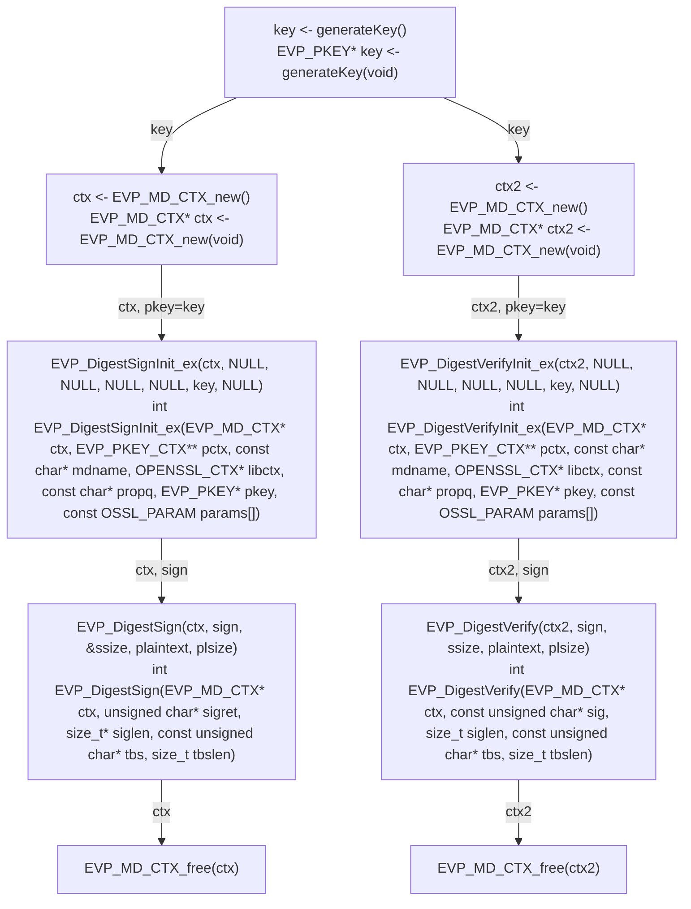

## ch7/pqc/pqc_hash_sign.c

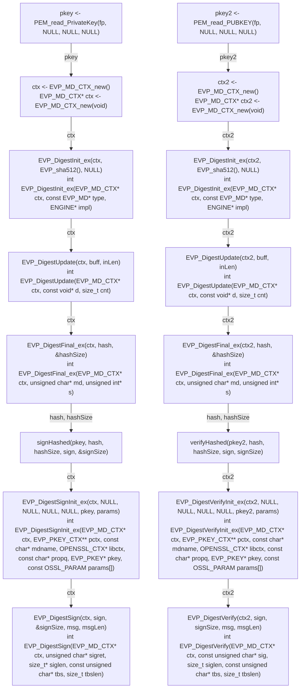

## ch8/pqc/pqc_client0.c

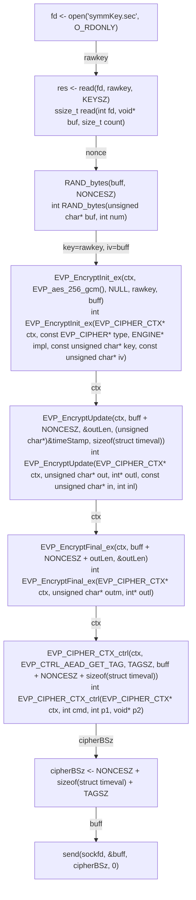

## ch8/pqc/pqc_server0.c

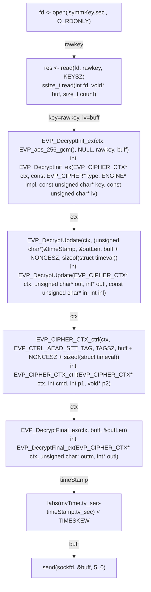

## ch9/pqc/pqc_ssl_client.c

```mermaid
flowchart TD
    A["meth <- TLS_client_method()
const SSL_METHOD* meth <- TLS_client_method(void)"] -->|"meth"| B["ctx <- SSL_CTX_new(meth)
SSL_CTX* ctx <- SSL_CTX_new(const SSL_METHOD* method)"]
    B -->|"ctx"| C["SSL_CTX_set_min_proto_version(ctx, TLS1_3_VERSION)
int SSL_CTX_set_min_proto_version(SSL_CTX* ctx, int version)"]
    C -->|"ctx"| D["SSL_CTX_set_max_proto_version(ctx, TLS1_3_VERSION)
int SSL_CTX_set_max_proto_version(SSL_CTX* ctx, int version)"]
    D -->|"ctx"| E["SSL_CTX_set1_groups_list(ctx, 'X25519MLKEM768:SecP384r1MLKEM1024')
int SSL_CTX_set1_groups_list(SSL_CTX* ctx, const char* groups)"]
    E -->|"ctx"| F["SSL_CTX_set1_sigalgs_list(ctx, 'mldsa65')
int SSL_CTX_set1_sigalgs_list(SSL_CTX* ctx, const char* sigalgs)"]
    F -->|"ctx"| G["SSL_CTX_load_verify_locations(ctx, 'CACert.pem', NULL)
int SSL_CTX_load_verify_locations(SSL_CTX* ctx, const char* CAfile, const char* CApath)"]
    G -->|"ctx"| H["SSL_CTX_set_verify(ctx, SSL_VERIFY_PEER, NULL)
void SSL_CTX_set_verify(SSL_CTX* ctx, int mode, int (*verify_callback)(int, X509_STORE_CTX*))"]
    H -->|"ctx"| I["sbio <- BIO_new_ssl_connect(ctx)
BIO* sbio <- BIO_new_ssl_connect(SSL_CTX* ctx)"]
    I -->|"sbio"| J["BIO_get_ssl(sbio, &ssl)
void BIO_get_ssl(BIO* bio, SSL** sslp)"]
    J -->|"ssl"| K["SSL_set_mode(ssl, SSL_MODE_AUTO_RETRY)
long SSL_set_mode(SSL* ssl, int mode)"]
    K -->|"ssl"| L["X509_VERIFY_PARAM_set1_host(SSL_get0_param(ssl), 'localhost', 0)
int X509_VERIFY_PARAM_set1_host(X509_VERIFY_PARAM* param, const char* name, size_t namelen)"]
    L -->|"sbio"| M["BIO_set_conn_hostname(sbio, '127.0.0.1:4433')
void BIO_set_conn_hostname(BIO* bio, const char* name)"]
    M -->|"sbio"| N["BIO_do_connect(sbio)
int BIO_do_connect(BIO* bio)"]
    N -->|"sbio"| O["BIO_do_handshake(sbio)
int BIO_do_handshake(BIO* bio)"]
    O -->|"ssl"| P["SSL_get0_group_name(ssl)
const char* group <- SSL_get0_group_name(const SSL* ssl)"]
    O -->|"ssl"| Q["SSL_get_cipher_name(ssl)
const char* name <- SSL_get_cipher_name(const SSL* ssl)"]
    O -->|"sbio"| R["BIO_puts(sbio, 'GET / HTTP/1.0\r\n\r\n')
int BIO_puts(BIO* b, const char* buf)"]
    R -->|"len"| S["len <- BIO_read(sbio, tmpbuf, 1024)
int len <- BIO_read(BIO* bio, void* data, int len)"]
    S -->|"out"| T["BIO_write(out, tmpbuf, len)
int BIO_write(BIO* bio, const void* data, int dlen)"]
    T --> U["BIO_free_all(sbio)
void BIO_free_all(BIO* bio)"]
    U --> V["SSL_CTX_free(ctx)
void SSL_CTX_free(SSL_CTX* ctx)"]
```

## ch9/pqc/pqc_ssl_server.c

```mermaid
flowchart TD
    A["meth <- TLS_server_method()
const SSL_METHOD* meth <- TLS_server_method(void)"] -->|"meth"| B["ctx <- SSL_CTX_new(meth)
SSL_CTX* ctx <- SSL_CTX_new(const SSL_METHOD* method)"]
    B -->|"ctx"| C["SSL_CTX_set_min_proto_version(ctx, TLS1_3_VERSION)
int SSL_CTX_set_min_proto_version(SSL_CTX* ctx, int version)"]
    C -->|"ctx"| D["SSL_CTX_set_max_proto_version(ctx, TLS1_3_VERSION)
int SSL_CTX_set_max_proto_version(SSL_CTX* ctx, int version)"]
    D -->|"ctx"| E["SSL_CTX_set1_groups_list(ctx, 'X25519MLKEM768:SecP384r1MLKEM1024')
int SSL_CTX_set1_groups_list(SSL_CTX* ctx, const char* groups)"]
    E -->|"ctx"| F["SSL_CTX_set1_sigalgs_list(ctx, 'mldsa65')
int SSL_CTX_set1_sigalgs_list(SSL_CTX* ctx, const char* sigalgs)"]
    F -->|"ctx"| G["SSL_CTX_use_certificate_chain_file(ctx, 'BobCert.pem')
int SSL_CTX_use_certificate_chain_file(SSL_CTX* ctx, const char* file)"]
    G -->|"ctx"| H["SSL_CTX_use_PrivateKey_file(ctx, 'BobPriv.pem', SSL_FILETYPE_PEM)
int SSL_CTX_use_PrivateKey_file(SSL_CTX* ctx, const char* file, int type)"]
    H -->|"ctx"| I["SSL_CTX_check_private_key(ctx)
int SSL_CTX_check_private_key(SSL_CTX* ctx)"]
    I -->|"ctx"| J["key <- SSL_CTX_get0_privatekey(ctx)
EVP_PKEY* key <- SSL_CTX_get0_privatekey(const SSL_CTX* ctx)"]
    J -->|"key"| K["EVP_PKEY_is_a(key, 'ML-DSA-65')
int EVP_PKEY_is_a(EVP_PKEY* pkey, const char* name)"]
    K -->|"ctx"| L["sbio <- BIO_new_ssl(ctx, 0)
BIO* sbio <- BIO_new_ssl(SSL_CTX* ctx, int server)"]
    L -->|"sbio"| M["BIO_get_ssl(sbio, &ssl)
void BIO_get_ssl(BIO* bio, SSL** sslp)"]
    M -->|"ssl"| N["SSL_set_mode(ssl, SSL_MODE_AUTO_RETRY)
long SSL_set_mode(SSL* ssl, int mode)"]
    N -->|"acpt"| O["acpt <- BIO_new_accept('4433')
BIO* acpt <- BIO_new_accept(const char* host_port)"]
    O -->|"acpt"| P["BIO_set_accept_bios(acpt, sbio)
void BIO_set_accept_bios(BIO* bio, BIO* accept_bio)"]
    P -->|"acpt"| Q["BIO_do_accept(acpt)
int BIO_do_accept(BIO* bio)"]
    Q -->|"sbio"| R["BIO_do_handshake(sbio)
int BIO_do_handshake(BIO* bio)"]
    R -->|"sbio"| S["BIO_puts(sbio, 'HTTP/1.0 200 OK...')
int BIO_puts(BIO* b, const char* buf)"]
    S -->|"len"| T["len <- BIO_gets(sbio, tmpbuf, 1024)
int len <- BIO_gets(BIO* bio, void* buf, int size)"]
    T -->|"sbio"| U["BIO_write(sbio, tmpbuf, len)
int BIO_write(BIO* bio, const void* data, int dlen)"]
    U --> V["BIO_flush(sbio)
int BIO_flush(BIO* b)"]
    V --> W["BIO_free_all(sbio)
void BIO_free_all(BIO* bio)"]
    W --> X["SSL_CTX_free(ctx)
void SSL_CTX_free(SSL_CTX* ctx)"]
```